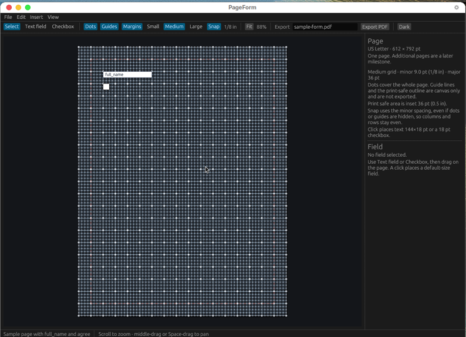

# PageForm

Free, open-source desktop app for designing fillable PDF forms. This milestone is one US Letter page (612 by 792 pt) with pan and zoom, a toggleable dot grid, and snap. Medium, the default grid, is 0.125 in minor and 0.5 in major. Small is 0.0625 in minor and 0.25 in major. Large is 0.25 in minor and 1 in major. Snap follows the active minor spacing, including when the dots are hidden, so columns and rows stay even. Guide lines and a 0.5 in print-safe outline can be shown on the canvas and are not written into the PDF. Export writes a fillable AcroForm file for the real fields. Windows and Linux only.

The window opens in the dark theme. A menu bar (File, Edit, Insert, View, Help) sits above the toolbar. The properties panel is on the right and starts hidden. Open it from View → Properties, the toolbar tune icon, or a right-click Properties command. Double-click static text, a text box, a radio or checkbox label, or a field's default text to edit it on the page. Enter finishes, Esc cancels, and Shift+Enter adds a line when the item is multi-line. Its header has a close button and a pin. A pinned panel stays open. An unpinned panel closes when you click empty canvas with the Select tool, or when the selection is deleted. That open and pinned state is saved, and Edit → Preferences can set both defaults. With nothing selected the panel edits page size, orientation, margins, grid size, and header and footer text. One item shows position, identity, type-specific fields, font, border or stroke, and a calculations placeholder. Shift-click or Ctrl-click selects several items and shows align, distribute, and match-size controls. Margins, header, footer, page numbers, and the grid stay on the canvas. Page size and orientation are the PDF media box. File lists New, Open, Save, Save As, Print, Export PDF, and Exit. New opens New Blank Document and New from Template. Export PDF opens a save dialog for the file name and location. If the system has no file dialog, PageForm asks for the folder and file name itself. Drag on empty canvas to select with a box. Edit, the properties panel, and the right-click menu can align, distribute, and match size when several items are selected. Exit closes the window. New Blank Document starts a blank page and asks before discarding unsaved work. New from Template opens a .pgt file as a new untitled document with no linked path, so Save asks for a new .pgd and does not change the template. Open reads .pgd documents, .pgt templates, and legacy .pageform files. Save stores a .pgd document. Save As can also store a .pgt template when Template is chosen, and asks before replacing an existing template. Print works. The window title shows the file name and a * when there are unsaved changes. Edit lists Select, Select All, Copy, Cut, Paste, Delete, and Preferences. Select, Select All, Copy, Cut, Paste, and Delete work. Preferences opens a settings dialog for Dark or Light, radio labels, and whether the properties panel opens and stays pinned. Insert lists its items alphabetically and drops a default-sized item at the center of the visible page, snapped to the grid. A toolbar insert tool places that default size on a click and sizes the item when you drag. The toolbar uses monochrome Material Symbols Light outline icons (Apache-2.0): New, Open, Save, and Print, then Select, Insert Page, and the insert tools in alphabetical order. Square and rectangle share one Shapes icon. Grid size, dots, guides, margins, page numbers, and snap are icons. Header and footer stay in the View menu. Export PDF is not on the toolbar. A moon or sun icon switches the theme, and that choice is restored the next time the app opens. The properties toggle is the Material Symbols Light `tune` icon. Help opens a separate FAQ window. About opens a centered dialog.

Insert menu, alphabetical:

| Item | What it is |
| --- | --- |
| Checkbox | Fillable AcroForm checkbox. |
| Date | Fillable AcroForm text field, `/MaxLen 10`, alternate name `YYYY-MM-DD`, appearance hint `YYYY-MM-DD`, default appearance `/Helv 12 Tf 0 g`. Not a calendar popup. |
| Drop-down | AcroForm combo box with Yes, No, and Other. Not a list box. |
| Image | Placeholder box with a cross. Choosing a file is not available yet. Not a form field. |
| Line | Stroke between two points. A menu click drops a horizontal line. Not a form field. |
| Radio | AcroForm radio button. A selected radio makes the next one join that group (Yes, then No, then Option 3). Edit → Preferences, Radio labels, hides the adjacent text. |
| Signature | Unsigned AcroForm signature field (`/FT /Sig`). The app does not capture ink or a picture. |
| Square/Rectangle | Stroked rectangle. Not a form field. |
| Table | Placeholder. A 3 by 2 grid of lines. Cells are not editable. Not a form field. |
| Text | Static one-line label. Page content, not a form field. |
| Text Box | Static text block with basic wrapping. Not a form field. |
| Text Field | One-line fillable AcroForm text field. |

Toolbar insert icons, alphabetical: Checkbox, Date, Drop-down, Image, Line, Radio, Shapes (Square or Rectangle), Signature, Table, Text, Text Box, Text Field. Edit has Select All, Copy, Cut, Paste, and Delete, with Ctrl or Cmd+A, C, X, and V. New Blank Document starts a blank page. New from Template opens a .pgt file as a new untitled document with no linked path. Open, Save, Save As, and Print work. Save As chooses Document (.pgd) or Template (.pgt), and an existing template asks before it is replaced. Insert Page is not implemented yet.




## Build

Install stable Rust, then:

```bash
cargo run -p pageform
cargo test --workspace
cargo run -p pageform -- --export sample-form.pdf
```

Scroll to zoom. Middle-drag, or hold Space and drag, to pan. `cargo run -p pageform -- --demo` opens the sample fields used by the export test.

## Download

GitHub Actions uploads two desktop builds from this repository.

Windows: download the `pageform-windows-exe` artifact and unzip it. `PageForm.exe` is at the zip root.

Linux: download the `pageform-linux-appimage` artifact and unzip it. `PageForm-x86_64.AppImage` is at the zip root. It is built on Ubuntu's glibc and runs on newer glibc desktops, including Arch, without installing PageForm's own libraries. It bundles `libxkbcommon-x11.so.0` and `libxcb-xkb.so.1`, which the window needs for keyboard input. A desktop session (Wayland or X11) and the host OpenGL libraries (`libGL` / `libEGL` from the GPU driver) still have to be present. The GPU driver is not inside the AppImage.

```bash
chmod +x PageForm-x86_64.AppImage
./PageForm-x86_64.AppImage
```

If Arch says FUSE is missing:

```bash
./PageForm-x86_64.AppImage --appimage-extract-and-run
```

## License

MIT. See [LICENSE](LICENSE).
